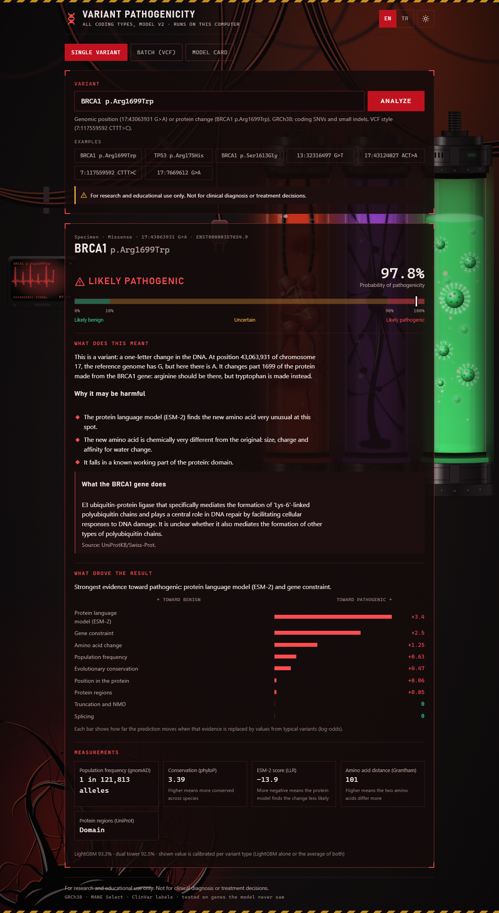
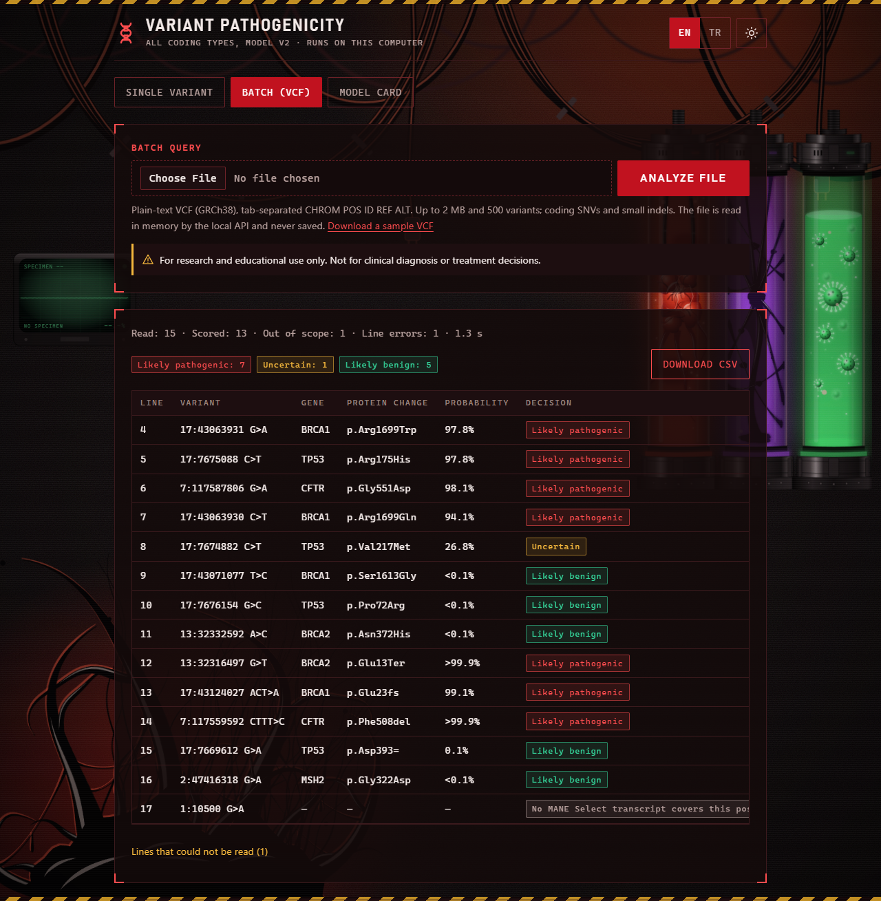
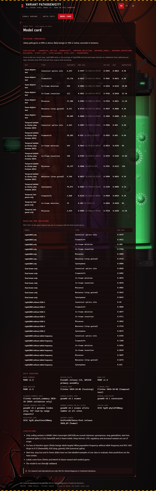
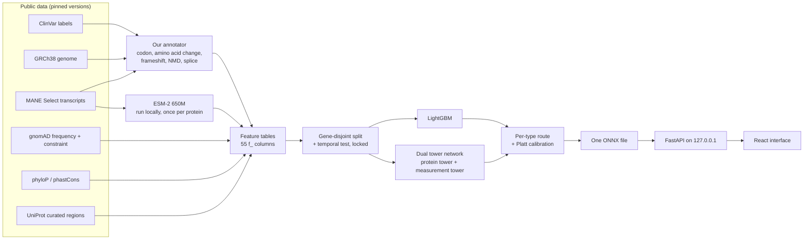

# Healthcare — Genetic Variant Pathogenicity Prediction

[English](#english) · [Türkçe](#türkçe)

> **Disclaimer:** This project is for research and educational purposes only. It must not be used for clinical
> diagnosis or treatment decisions.

---

## English

A model trained from scratch that predicts whether a germline genetic variant in a protein-coding gene is
**pathogenic** or **benign**, plus a web interface that runs on your own machine.

It uses no precomputed pathogenicity scores. CADD, REVEL, AlphaMissense, SpliceAI, SIFT, PolyPhen-2, dbNSFP and
every other variant-effect predictor are left out as features, labels and filters; AlphaMissense and REVEL appear only as an external yardstick, scored next to the finished model. The model learns only from raw public data and from features computed in this repository, including
ESM-2 protein language model outputs run locally. Variant consequences (codon, amino acid change, frameshift, NMD)
come from our own annotator built on MANE Select, not from VEP.

Contents: [Try the demo](#try-the-demo) · [Screenshots](#screenshots) · [Results](#results) ·
[Comparison with AlphaMissense and REVEL](#comparison-with-alphamissense-and-revel) · [How it works](#how-it-works) ·
[Data sources and licenses](#data-sources-and-licenses) · [Reproduce from scratch](#reproduce-from-scratch) ·
[Use the model](#use-the-model) · [Limitations](#limitations) · [Model card](reports/model_card.md)

### Try the demo

The full data is about 240 GB. The demo pack (`healthcare-demo-v2.zip`, ~110 MB, attached to the GitHub release) holds
the same ONNX model plus every lookup table it needs for 14 well-known disease genes: APC, BRCA1, BRCA2, CFTR, FBN1,
KCNQ1, LDLR, MLH1, MSH2, MYH7, PTEN, RYR1, SCN5A and TP53 (26 genes once overlapping ones are included). Inside those
genes it gives exactly the same predictions as the full data; anything else gets an "outside the demo pack" message.

```bash
git clone https://github.com/YusufHasanSaygili/Healthcare.git
cd Healthcare
uv sync
# download healthcare-demo-v2.zip from the latest release and unzip it here; it creates demo/
uv run healthcare predict --demo "BRCA1 p.Arg1699Trp"
uv run healthcare serve --demo
```

Then start the web interface as described in [Use the model](#use-the-model). `uv sync` still installs PyTorch,
because training code shares the package; the demo itself only runs ONNX Runtime on the CPU.

### Screenshots

| Single variant | Batch (VCF) | Model card |
|---|---|---|
|  |  |  |

### Results

All numbers come from data the model never saw during training or model selection. Every table is split by variant
type, because the type alone almost separates the labels (nearly all ClinVar frameshifts are pathogenic, nearly all
synonymous variants benign) and a pooled number would look better than the model is.

**Gene-disjoint test set** (whole genes held out, opened once, model unchanged afterwards).
Full report: [`reports/all_types_v2.md`](reports/all_types_v2.md).

| Variant type | Variants (minority class) | ROC-AUC [95% gene bootstrap CI] | PR-AUC | Uncertain | Without allele frequency |
|---|---|---|---|---|---|
| Missense | 27,500 (8,003 P) | 0.990 [0.989–0.992] | 0.976 | 11.2% | 0.961 |
| Stop gained | 8,531 (67 B) | 0.972 [0.954–0.989] | 0.9997 | 0.3% | 0.827 |
| Canonical splice | 6,293 (91 B) | 0.950 [0.926–0.973] | 0.999 | 0.5% | 0.840 |
| Frameshift | 14,176 (138 B) | 0.902 [0.841–0.959] | 0.998 | 0.5% | 0.721 |
| In-frame deletion | 490 (191 B) | 0.990 [0.982–0.997] | 0.992 | 10.8% | 0.948 |
| In-frame insertion | 213 (87 P) | 0.985 [0.967–0.998] | 0.978 | 22.1% | 0.894 |
| Synonymous | 98,509 (81 P) | 0.889 [0.836–0.936] | 0.290 | 0.1% | 0.831 |

P = pathogenic, B = benign. Start lost, stop lost and in-frame delins have too few variants of one class to score.

**Temporal test** (variants first added to ClinVar between October 2025 and October 2026, after the training
release):

| Variant type | All temporal genes | Genes never seen in training |
|---|---|---|
| Missense | 0.989 (18,197) | 0.988 (2,919) |
| Frameshift | 0.934 (20,585) | 0.822 (2,848) |
| Stop gained | 0.883 (9,346) | too few benign |
| Canonical splice | 0.909 (6,563) | too few benign |
| In-frame deletion | 0.985 (534) | 0.983 (75) |
| Synonymous | 0.858 (74,871) | too few pathogenic |

- Missense keeps ROC-AUC 0.99 on held-out genes and on newer variants. ESM-2 adds about 0.005 test ROC-AUC on top
  of the other features, and about 0.02 on validation when allele frequency is removed.
- Most ClinVar benign labels for frameshift, stop-gained and splice variants were given because the variant is
  common in the population. Without allele frequency, frameshift falls to 0.72, so that column shows what the
  model learned beyond "common means benign".
- Only 81 of 98,509 synonymous test variants are pathogenic, and PR-AUC is 0.29. The model rarely flags one with
  confidence.
- Calibration drifts on newer variants: missense ECE is 0.002 on the test set and 0.032 on the temporal set, where
  the model is overconfident between 0.3 and 0.8.
- The first, missense-only model (v1) scored 0.990 on the same test genes; see
  [`reports/missense_v1.md`](reports/missense_v1.md).

The decision shown to users is three-way, on the calibrated probability: **Likely pathogenic** (≥ 0.90),
**Likely benign** (≤ 0.10), otherwise **Uncertain**. Thresholds and calibration were fixed on the validation set.

### Comparison with AlphaMissense and REVEL

All four scorers were measured on the same locked missense variants, after our models were frozen (model files
hashed before and after). The external scores were used for this evaluation only, never as an input. Full report:
[`reports/external_comparison.md`](reports/external_comparison.md).

| Missense ROC-AUC | Gene-disjoint test (26,522) | Temporal, all genes (17,671) | Temporal, test genes (2,800) |
|---|---|---|---|
| Ours: v2 | **0.990** | **0.989** | **0.988** |
| Ours: LightGBM without allele frequency | 0.960 | 0.973 | 0.966 |
| AlphaMissense (2023) | 0.972 | 0.965 | 0.971 |
| REVEL (2016) | 0.977 | 0.973 | 0.974 |

- The full v2 model ranks variants better than both tools on every set, with non-overlapping 95% gene-bootstrap
  intervals.
- Much of that lead comes from allele frequency. Without it our LightGBM sits slightly below both tools on the
  gene-disjoint sets, and level with REVEL and above AlphaMissense on the temporal set.
- When v2 calls a variant likely pathogenic it is right 96–98% of the time, against 88–90% for AlphaMissense's own
  likely-pathogenic class. v2 leaves more variants uncertain (11–14% against 5%).
- Caveats that favour the external tools: they may have been trained or calibrated with these variants and genes,
  and since 2022 ClinVar submitters can cite REVEL and AlphaMissense as evidence, so some newer labels partly rest
  on their scores. AlphaMissense is also frequency-informed through its training labels.

**All 37 predictors in dbNSFP 5.4a.** Each tool was scored on the variants it covers and our v2 model on exactly the
same variants; a tool counts as beaten or ahead only when the paired 95% gene-bootstrap interval of the difference
excludes zero.

| Set | We are ahead | No clear difference | Tool is ahead |
|---|---|---|---|
| Temporal, all genes (added to ClinVar after October 2025) | **37** | 0 | 0 |
| Temporal, test genes only | 34 | 3 (ClinPred, MetaRNN, BayesDel with AF) | 0 |
| Gene-disjoint test | 34 | 1 (BayesDel with AF) | 2 (MetaRNN −0.0025, ClinPred −0.0017) |

The tools that come closest (MetaRNN, ClinPred, BayesDel with AF) use allele frequency and were trained on ClinVar
labels, so on the gene-disjoint test set they may have seen our test variants; on the newer temporal variants our
model is ahead of every one of them. Without allele frequency our LightGBM reaches 0.973 on the temporal set, level with
the strongest frequency-free tools (REVEL, BayesDel without AF), but 0.960 on the gene-disjoint test set, where
several frequency-free tools rank higher (REVEL and BayesDel without AF 0.976, VARITY 0.972).

<details>
<summary>Every tool, set by set (missense ROC-AUC)</summary>

Tool scores on the variants each tool covers. ✅ our v2 model is ahead, ➖ no clear difference, ❌ the tool is ahead (paired 95% gene-bootstrap interval of the difference). Our v2 scores 0.987–0.991 on each tool's variants. dbNSFP holds missense scores only, so the other variant types have no external comparison.

| Tool | Gene-disjoint test | Temporal, all genes | Temporal, test genes |
|---|---|---|---|
| **Ours: v2** | **0.990** | **0.989** | **0.988** |
| MetaRNN | 0.993 ❌ | 0.985 ✅ | 0.989 ➖ |
| ClinPred | 0.992 ❌ | 0.981 ✅ | 0.989 ➖ |
| BayesDel (with AF) | 0.990 ➖ | 0.981 ✅ | 0.984 ➖ |
| MutationTaster | 0.987 ✅ | 0.977 ✅ | 0.977 ✅ |
| PHACTboost | 0.985 ✅ | 0.975 ✅ | 0.978 ✅ |
| MutScore | 0.979 ✅ | 0.979 ✅ | 0.983 ✅ |
| REVEL | 0.976 ✅ | 0.973 ✅ | 0.973 ✅ |
| BayesDel (no AF) | 0.976 ✅ | 0.972 ✅ | 0.973 ✅ |
| VEST4 | 0.973 ✅ | 0.966 ✅ | 0.973 ✅ |
| VARITY_R | 0.973 ✅ | 0.971 ✅ | 0.976 ✅ |
| AlphaMissense | 0.971 ✅ | 0.966 ✅ | 0.972 ✅ |
| VARITY_ER | 0.968 ✅ | 0.969 ✅ | 0.973 ✅ |
| gMVP | 0.967 ✅ | 0.972 ✅ | 0.965 ✅ |
| MutPred2 | 0.963 ✅ | 0.968 ✅ | 0.969 ✅ |
| Eigen | 0.954 ✅ | 0.948 ✅ | 0.962 ✅ |
| CADD | 0.953 ✅ | 0.936 ✅ | 0.954 ✅ |
| DEOGEN2 | 0.951 ✅ | 0.954 ✅ | 0.959 ✅ |
| MutFormer | 0.951 ✅ | 0.927 ✅ | 0.936 ✅ |
| M-CAP | 0.948 ✅ | 0.941 ✅ | 0.943 ✅ |
| MVP | 0.947 ✅ | 0.954 ✅ | 0.947 ✅ |
| MisFit | 0.947 ✅ | 0.950 ✅ | 0.951 ✅ |
| MetaLR | 0.944 ✅ | 0.943 ✅ | 0.938 ✅ |
| MetaSVM | 0.943 ✅ | 0.942 ✅ | 0.939 ✅ |
| PolyPhen-2 HVAR | 0.942 ✅ | 0.937 ✅ | 0.954 ✅ |
| FATHMM-XF | 0.942 ✅ | 0.936 ✅ | 0.951 ✅ |
| GPN-MSA | 0.939 ✅ | 0.933 ✅ | 0.956 ✅ |
| popEVE | 0.939 ✅ | 0.933 ✅ | 0.943 ✅ |
| ESM1b | 0.937 ✅ | 0.942 ✅ | 0.941 ✅ |
| PROVEAN | 0.936 ✅ | 0.935 ✅ | 0.944 ✅ |
| SIFT | 0.931 ✅ | 0.919 ✅ | 0.939 ✅ |
| PolyPhen-2 HDIV | 0.930 ✅ | 0.918 ✅ | 0.939 ✅ |
| MutationAssessor | 0.929 ✅ | 0.935 ✅ | 0.930 ✅ |
| SIFT4G | 0.922 ✅ | 0.920 ✅ | 0.932 ✅ |
| LIST-S2 | 0.917 ✅ | 0.900 ✅ | 0.929 ✅ |
| DANN | 0.903 ✅ | 0.871 ✅ | 0.910 ✅ |
| PrimateAI | 0.898 ✅ | 0.889 ✅ | 0.904 ✅ |
| MPC | 0.887 ✅ | 0.854 ✅ | 0.877 ✅ |

</details>

### How it works



- **Annotator** (`src/healthcare/annotate/`): maps a GRCh38 SNV or small indel onto the MANE Select transcript of
  its gene and works out the effect: missense, synonymous, stop gained/lost, start lost, canonical splice (intron
  ±1/2), frameshift, in-frame deletion/insertion/delins. Indels are left-normalized and the reference allele is
  checked against the genome. Agreement with ClinVar's own protein change is 100% for missense SNVs and 99.3–100%
  for indel types.
- **Features** (`src/healthcare/features/`): amino acid physicochemistry (Grantham, BLOSUM62, hydrophobicity,
  volume, charge), conservation at the site, gnomAD allele frequency and whether the site was covered at all, gene
  constraint (LOEUF, missense Z), UniProt curated regions, position in the protein, and type-specific features
  (truncation point, nonsense-mediated decay rule, stop-loss extension, next in-frame Met, skipped-exon frame, indel
  length). Only `f_`-prefixed columns reach a model; ClinVar metadata never does.
- **Protein tower** (`src/healthcare/esm/`): ESM-2 (`esm2_t33_650M_UR50D`) runs once over all 19,228 MANE proteins.
  From its outputs we compute the wild-type vs mutant log-likelihood ratio, the site entropy and the embedding
  around the variant.
- **Models** (`src/healthcare/models/`): LightGBM, and a dual tower network (protein tower + measurement tower +
  fusion head). The protein tower is randomly masked during training so the same network also decides for types
  without a protein position. For each variant type the validation set chose either LightGBM alone or the average
  of both, followed by a per-type Platt calibration. Everything is exported to one ONNX file (14 MB); serving needs
  ONNX Runtime and DuckDB, not PyTorch.
- **Evaluation** (`src/healthcare/split/`, `src/healthcare/evaluate/`): all variants of a gene fall into one of
  train / validation / test (70/15/15, fixed seed, genes with overlapping coding sequence grouped). Test and temporal
  rows live in a separate locked folder that the training code cannot read without an explicit flag. Automated tests
  check that no gene and no variant appears in two sets.
- **Explanation**: for each prediction the service swaps one feature group at a time with values from 32 training
  variants and reports how much the calibrated log-odds move. The web interface draws these changes as a bar chart.

### Data sources and licenses

Versions, URLs and checksums are pinned in [`config/sources.toml`](config/sources.toml). Nothing is downloaded at
"latest".

UniProt is the one exception to fixed URLs: release 2026_03 is still UniProt's current release and has no archive
URL yet, so it is fetched from `current_release` and pinned by its sha256. Once UniProt publishes 2026_04 the
download stops with a checksum error; the 2026_03 archive (`previous_releases/release-2026_03/knowledgebase/`,
all species, ~1.6 GB) will then be the source.

| Source | Version | Used for | License / terms |
|---|---|---|---|
| [ClinVar](https://www.ncbi.nlm.nih.gov/clinvar/) | 2025-10-06 (training), 2026-10-04 (temporal test) | Labels only (classification ≥ 1 review star) | Public domain (NCBI); cite Landrum et al., *Nucleic Acids Res* 2018 |
| [GRCh38 primary assembly](https://www.ensembl.org/) | Ensembl release 115 | Reference bases, codons | Ensembl data: no restrictions |
| [MANE Select](https://www.ncbi.nlm.nih.gov/refseq/MANE/) | v1.5 | One transcript and protein per gene | Public domain (NCBI / EMBL-EBI); cite Morales et al., *Nature* 2022 |
| [gnomAD](https://gnomad.broadinstitute.org/) | v4.1 exomes, constraint, allele number at all sites | Allele frequency, site coverage, gene constraint | CC0 1.0; cite Chen et al., *Nature* 2024 |
| [UCSC phyloP100way / phastCons100way](https://genome.ucsc.edu/) | hg38 | Conservation | Free for academic and personal use, see UCSC conditions; cite Pollard et al. 2010, Siepel et al. 2005 |
| [UniProtKB/Swiss-Prot](https://www.uniprot.org/) | 2026_03, human | Curated protein regions | CC BY 4.0 |
| [ESM-2](https://github.com/facebookresearch/esm) | `facebook/esm2_t33_650M_UR50D`, pinned revision | Protein tower (weights only, run locally) | MIT |
| Amino acid tables | Grantham 1974, BLOSUM62 (Henikoff 1992), Kyte–Doolittle 1982 | Physicochemistry | Published literature |

Used only by `healthcare compare-external`, never by the model ([`config/external_sources.toml`](config/external_sources.toml)):
[AlphaMissense](https://github.com/google-deepmind/alphamissense) hg38 scores (CC BY-NC-SA 4.0; Cheng et al., *Science*
2023) and [REVEL](https://sites.google.com/site/revelgenomics/) v1.3 (free for non-commercial use; Ioannidis et al.,
*Am J Hum Genet* 2016), and the [dbNSFP](https://www.dbnsfp.org/) 5.4a academic branch (CC BY-NC-ND 4.0; free
academic registration, then place `dbNSFP5.4a_grch38.gz` and its `.tbi` in `data/raw/dbnsfp/`). No per-variant external score is stored in this repository.

### Reproduce from scratch

Everything below runs on one desktop machine. Developed on Windows 11 with an RTX 4070 Ti (12 GB), an i5-13600KF
and an NVMe drive.

**Requirements**

- Python 3.12 and [uv](https://docs.astral.sh/uv/); Node.js 20.19+ or 22.12+ for the interface
- An NVIDIA GPU with CUDA for ESM-2 and the dual tower (CPU is enough for serving)
- About **240 GB** of free disk: raw downloads ~196 GB (mostly gnomAD), intermediate and processed tables ~6 GB,
  ESM-2 outputs and models ~38 GB

**Steps.** Each command skips work whose output already exists (`--force` rebuilds), writes a log under `logs/` and a
small summary JSON under `logs/summaries/`. Most build steps accept `--chrom 22` to try one chromosome first.

```bash
uv sync
uv run healthcare doctor                  # Python, PyTorch, CUDA, GPU, free disk

# 1. Download pinned sources (resumable, checksum-verified; ~196 GB, hours)
uv run healthcare download

# 2. Reference data and labels
uv run healthcare build-transcripts       # MANE transcripts, translation check
uv run healthcare build-clinvar           # labels, VUS, temporal and reclassification tables
uv run healthcare build-annotations       # our annotator over ClinVar
uv run healthcare build-gnomad            # gnomAD exomes -> Parquet (longest step)
uv run healthcare build-conservation
uv run healthcare build-uniprot
uv run healthcare build-esm               # ESM-2 over all MANE proteins (~11 min on a 4070 Ti)

# 3. Features and the gene-disjoint split
uv run healthcare build-features          # missense table
uv run healthcare build-split --force     # --force on a fresh clone, see below
uv run healthcare build-phase2-features   # other coding types
uv run healthcare build-phase2-split

# 4. Models (the dual tower uses the configuration committed in reports/dual_tower.json)
uv run healthcare train-joint-baseline    # LightGBM sweep
uv run healthcare prepare-joint-dual-tower
uv run healthcare train-joint-dual-tower  # ~1.5 h on a 4070 Ti
uv run healthcare choose-final-v2         # routes, calibration and ablations on validation only
uv run healthcare export-onnx-v2          # artifacts/models/all_types_v2.onnx

# 5. Optional: re-run the final evaluation on the locked test set
uv run healthcare evaluate-final-v2 --force

# 6. Optional: build the demo pack (artifacts/demo/healthcare-demo-v2.zip)
uv run healthcare build-demo

# 7. Optional: score AlphaMissense and REVEL on the same locked variants (downloads ~1.3 GB)
uv run healthcare compare-external
```

`build-demo` also checks the pack against the full data on 200 open-split variants of the pack genes and writes the
result to `logs/summaries/build-demo.json` (expected: 0 feature and 0 decision differences).

`build-split` refuses to run when `reports/split_summary.json` pins a split file that is missing, which is the case
on a fresh clone. `--force` rebuilds it with the fixed seed; afterwards `git diff reports/split_summary.json` should
be empty, which confirms you got the same split. The dual tower hyperparameter search from the first phase
(`sweep-dual-tower`, `confirm-dual-tower`, about 8 hours) is not needed to rebuild the final model.

### Use the model

**Command line.** Give a genomic position (VCF style; indels are left-normalized for you) or a protein change:

```bash
uv run healthcare predict "17:43063931 G>A"
uv run healthcare predict "17:43124027 ACT>A"
uv run healthcare predict BRCA1 p.Arg1699Trp
```

The output shows the variant type, the calibrated probability, the three-way decision and the evidence groups that
moved it most. Variants outside coding regions get an explicit out-of-scope message.

**API.** It binds to `127.0.0.1` only; interactive docs open at `http://127.0.0.1:8000/docs`.

```bash
uv run healthcare serve
```

Endpoints: `/api/health`, `/api/predict`, `/api/predict/batch` (plain-text VCF, up to 2 MB and 500 variants, read
in memory and never stored), `/api/model-card`.

**Web interface.** With the API running, start it in a second terminal and open `http://127.0.0.1:5173`:

```bash
cd web
npm install
npm run dev
```

Three pages: **Single variant** (decision, probability gauge, chart of the evidence behind the decision),
**Batch (VCF)** (results table and CSV download; try `web/public/sample.vcf`) and **Model card**. Light and dark
themes, English and Turkish.

**Tests**

```bash
uv run pytest
uv run ruff check
cd web && npm test && npm run build
```

After changing an API schema, run `uv run healthcare openapi` and `npm run gen:api` in `web/`; a pytest check fails
until the frontend types are regenerated.

### Limitations

- **Scope:** GRCh38, MANE Select transcripts, coding SNVs and small indels only. Deep intronic, non-canonical
  splice, UTR, regulatory, mitochondrial, structural and somatic variants are out of scope: without splice or
  regulatory predictors, which this project does not use, there is no reliable signal for them.
- **Labels:** ClinVar contains errors and its benign labels for loss-of-function variants largely
  reflect population frequency, so part of the measured skill is the model learning that rule.
- **Population bias:** gnomAD and ClinVar over-represent people of European ancestry; frequency-based evidence is
  weaker for under-represented groups.
- **Small classes:** benign loss-of-function and pathogenic synonymous variants number in the tens to low hundreds
  in the test set, so their confidence intervals are wide. Start loss, stop loss and in-frame delins could not be
  scored at all.
- **Calibration drift:** probabilities on variants submitted after the training release are overconfident in the
  middle range.
- **One transcript per gene:** effects on other isoforms are ignored.
- **Clinical use:** none. No clinical validation was done. The output is a research estimate, not an ACMG
  classification.

---

## Türkçe

Protein kodlayan bir gendeki germline genetik varyantın **patojenik** mi **benign** mi olduğunu tahmin eden,
sıfırdan eğitilmiş bir model ve kendi bilgisayarında çalışan bir web arayüzü.

Hiçbir hazır patojenite skoru kullanılmaz. CADD, REVEL, AlphaMissense, SpliceAI, SIFT, PolyPhen-2, dbNSFP ve diğer
tüm varyant etkisi tahmin araçları özellik, etiket ya da filtre olarak dışarıda bırakıldı; AlphaMissense ve REVEL yalnızca bitmiş modelin yanında dış ölçüt olarak puanlandı. Model yalnızca ham açık verilerden ve bu depoda hesaplanan özelliklerden öğrenir; ESM-2 protein dil
modelinin çıktıları da yerelde hesaplanır. Varyant etkileri (kodon, amino asit değişimi, frameshift, NMD) VEP'ten
değil, MANE Select üzerine kurulu kendi anotatörümüzden gelir.

İçerik: [Demoyu deneyin](#demoyu-deneyin) · [Ekran görüntüleri](#ekran-görüntüleri) · [Sonuçlar](#sonuçlar) ·
[AlphaMissense ve REVEL ile karşılaştırma](#alphamissense-ve-revel-ile-karşılaştırma) · [Nasıl çalışır](#nasıl-çalışır) ·
[Veri kaynakları ve lisanslar](#veri-kaynakları-ve-lisanslar) · [Sıfırdan yeniden üretme](#sıfırdan-yeniden-üretme) ·
[Modeli kullanma](#modeli-kullanma) · [Sınırlamalar](#sınırlamalar) · [Model kartı](reports/model_card.md)

### Demoyu deneyin

Tam veri yaklaşık 240 GB tutar. Demo paketi (`healthcare-demo-v2.zip`, ~110 MB, GitHub sürümüne ekli) aynı ONNX
modelini ve 14 bilinen hastalık geni için gereken tüm arama tablolarını içerir: APC, BRCA1, BRCA2, CFTR, FBN1, KCNQ1,
LDLR, MLH1, MSH2, MYH7, PTEN, RYR1, SCN5A ve TP53 (örtüşen genlerle birlikte 26 gen). Bu genlerde tam veriyle
birebir aynı tahminleri verir; diğer varyantlar için "demo paketinin dışında" mesajı gösterilir.

```bash
git clone https://github.com/YusufHasanSaygili/Healthcare.git
cd Healthcare
uv sync
# healthcare-demo-v2.zip dosyasını son sürümden indirip buraya açın; demo/ klasörü oluşur
uv run healthcare predict --demo "BRCA1 p.Arg1699Trp"
uv run healthcare serve --demo
```

Ardından web arayüzünü [Modeli kullanma](#modeli-kullanma) bölümündeki gibi başlatın. Eğitim koduyla aynı paketi
paylaştığı için `uv sync` yine PyTorch kurar; demonun kendisi yalnızca CPU üzerinde ONNX Runtime çalıştırır.

### Ekran görüntüleri

| Tek varyant | Toplu (VCF) | Model kartı |
|---|---|---|
|  |  |  |

### Sonuçlar

Tüm sayılar, modelin eğitimde ve model seçiminde hiç görmediği verilerden gelir. Her tablo varyant türüne göre
ayrılmıştır: tür tek başına etiketleri neredeyse ayırır (ClinVar'daki frameshift'lerin neredeyse hepsi patojenik,
synonymous varyantların neredeyse hepsi benign), bu yüzden türleri karıştıran tek bir sayı modeli olduğundan iyi
gösterirdi.

**Gen bazında ayrık test seti** (genlerin tamamı ayrı tutuldu, bir kez açıldı, sonrasında model değişmedi).
Tam rapor (İngilizce): [`reports/all_types_v2.md`](reports/all_types_v2.md).

| Varyant türü | Varyant (azınlık sınıfı) | ROC-AUC [%95 gen bootstrap GA] | PR-AUC | Belirsiz | Alel frekansı olmadan |
|---|---|---|---|---|---|
| Missense | 27.500 (8.003 P) | 0,990 [0,989–0,992] | 0,976 | %11,2 | 0,961 |
| Stop kazanımı | 8.531 (67 B) | 0,972 [0,954–0,989] | 0,9997 | %0,3 | 0,827 |
| Kanonik splice | 6.293 (91 B) | 0,950 [0,926–0,973] | 0,999 | %0,5 | 0,840 |
| Frameshift | 14.176 (138 B) | 0,902 [0,841–0,959] | 0,998 | %0,5 | 0,721 |
| In-frame silme | 490 (191 B) | 0,990 [0,982–0,997] | 0,992 | %10,8 | 0,948 |
| In-frame ekleme | 213 (87 P) | 0,985 [0,967–0,998] | 0,978 | %22,1 | 0,894 |
| Synonymous | 98.509 (81 P) | 0,889 [0,836–0,936] | 0,290 | %0,1 | 0,831 |

P = patojenik, B = benign. Start kaybı, stop kaybı ve in-frame delins'te bir sınıftan skorlanacak kadar örnek yok.

**Zamansal test** (eğitim sürümünden sonra, Ekim 2025 ile Ekim 2026 arasında ClinVar'a ilk kez eklenen varyantlar):

| Varyant türü | Tüm zamansal genler | Eğitimde hiç görülmemiş genler |
|---|---|---|
| Missense | 0,989 (18.197) | 0,988 (2.919) |
| Frameshift | 0,934 (20.585) | 0,822 (2.848) |
| Stop kazanımı | 0,883 (9.346) | benign sayısı yetersiz |
| Kanonik splice | 0,909 (6.563) | benign sayısı yetersiz |
| In-frame silme | 0,985 (534) | 0,983 (75) |
| Synonymous | 0,858 (74.871) | patojenik sayısı yetersiz |

- Missense, ayrı tutulan genlerde de yeni varyantlarda da ROC-AUC 0,99'u koruyor. ESM-2 diğer özelliklerin
  üzerine testte yaklaşık 0,005 ROC-AUC, alel frekansı çıkarıldığında ise doğrulamada yaklaşık 0,02 ekliyor.
- ClinVar'daki benign frameshift, stop kazanımı ve splice etiketlerinin çoğu, varyant toplumda yaygın olduğu için
  verilmiş. Alel frekansı olmadan frameshift 0,72'ye düşüyor; bu sütun modelin "yaygınsa benigndir" kuralının
  ötesinde ne öğrendiğini gösteriyor.
- Test setindeki 98.509 synonymous varyantın yalnızca 81'i patojenik ve PR-AUC 0,29. Model bunları nadiren güvenle
  işaretliyor.
- Yeni varyantlarda kalibrasyon kayıyor: missense ECE testte 0,002, zamansal sette 0,032; model 0,3–0,8 aralığında
  fazla emin.
- İlk, yalnızca missense modeli (v1) aynı test genlerinde 0,990 aldı; bkz.
  [`reports/missense_v1.md`](reports/missense_v1.md).

Kullanıcıya gösterilen karar, kalibre edilmiş olasılık üzerinde üç yollu: **Muhtemelen patojenik** (≥ 0,90),
**Muhtemelen benign** (≤ 0,10), aksi halde **Belirsiz**. Eşikler ve kalibrasyon doğrulama setinde sabitlendi.

### AlphaMissense ve REVEL ile karşılaştırma

Dört skorlayıcı da aynı kilitli missense varyantlarında, modellerimiz dondurulduktan sonra ölçüldü (model dosyalarının
hash'i öncesinde ve sonrasında kontrol edildi). Dış skorlar yalnızca bu değerlendirmede kullanıldı, hiçbir zaman
girdi olmadı. Tam rapor (İngilizce): [`reports/external_comparison.md`](reports/external_comparison.md).

| Missense ROC-AUC | Gen bazında ayrık test (26.522) | Zamansal, tüm genler (17.671) | Zamansal, test genleri (2.800) |
|---|---|---|---|
| Bizim: v2 | **0,990** | **0,989** | **0,988** |
| Bizim: alel frekansı olmadan LightGBM | 0,960 | 0,973 | 0,966 |
| AlphaMissense (2023) | 0,972 | 0,965 | 0,971 |
| REVEL (2016) | 0,977 | 0,973 | 0,974 |

- Tam v2 modeli her sette iki araçtan da daha iyi sıralıyor; %95 gen bootstrap aralıkları örtüşmüyor.
- Bu farkın önemli kısmı alel frekansından geliyor. Frekanssız LightGBM'imiz gen bazında ayrık setlerde iki aracın
  biraz altında, zamansal sette ise REVEL ile başa baş ve AlphaMissense'in üstünde.
- v2 bir varyanta "muhtemelen patojenik" dediğinde %96–98 haklı; AlphaMissense'in kendi "muhtemelen patojenik"
  sınıfında bu oran %88–90. v2 daha fazla varyantı belirsiz bırakıyor (%11–14'e karşı %5).
- Dış araçların lehine işleyen uyarılar: bu varyant ve genlerle eğitilmiş ya da kalibre edilmiş olabilirler; 2022'den
  beri ClinVar'a bildirim yapanlar REVEL ve AlphaMissense'i kanıt olarak gösterebildiği için bazı yeni etiketler
  kısmen bu skorlara dayanıyor. AlphaMissense eğitim etiketleri üzerinden nüfus sıklığını da dolaylı olarak kullanıyor.

**dbNSFP 5.4a'daki 37 tahmin aracının hepsi.** Her araç kendi skorladığı varyantlarda, bizim v2 modelimiz de tam olarak
aynı varyantlarda ölçüldü. Bir aracı geçtik ya da araç önde demek için farkın eşleştirilmiş %95 gen bootstrap
aralığının sıfırı içermemesi gerekiyor.

| Set | Biz öndeyiz | Belirgin fark yok | Araç önde |
|---|---|---|---|
| Zamansal, tüm genler (Ekim 2025'ten sonra ClinVar'a eklenen) | **37** | 0 | 0 |
| Zamansal, yalnızca test genleri | 34 | 3 (ClinPred, MetaRNN, frekanslı BayesDel) | 0 |
| Gen bazında ayrık test | 34 | 1 (frekanslı BayesDel) | 2 (MetaRNN −0,0025, ClinPred −0,0017) |

Bize en çok yaklaşan araçlar (MetaRNN, ClinPred, frekanslı BayesDel) alel frekansını kullanıyor ve ClinVar
etiketleriyle eğitildi; bu yüzden gen bazında ayrık test setinde test varyantlarımızı görmüş olabilirler. Daha yeni
zamansal varyantlarda modelimiz hepsinin önünde. Alel frekansı olmadan LightGBM'imiz zamansal sette 0,973 alıyor ve frekans
kullanmayan en güçlü araçlarla (REVEL, frekanssız BayesDel) başa baş. Gen bazında ayrık test setinde ise 0,960'ta kalıyor;
orada birkaç frekanssız araç daha yüksek (REVEL ve frekanssız BayesDel 0,976, VARITY 0,972).

<details>
<summary>Araç araç, set set tüm sonuçlar (missense ROC-AUC)</summary>

Her aracın kendi kapsadığı varyantlardaki skoru. ✅ bizim v2 önde, ➖ belirgin fark yok, ❌ araç önde (farkın eşleştirilmiş %95 gen bootstrap aralığı). v2 her aracın varyantlarında 0,987–0,991 alıyor. dbNSFP yalnızca missense skorları içerdiği için diğer varyant türlerinin dış karşılaştırması yok.

| Araç | Gen bazında ayrık test | Zamansal, tüm genler | Zamansal, test genleri |
|---|---|---|---|
| **Bizim: v2** | **0,990** | **0,989** | **0,988** |
| MetaRNN | 0,993 ❌ | 0,985 ✅ | 0,989 ➖ |
| ClinPred | 0,992 ❌ | 0,981 ✅ | 0,989 ➖ |
| BayesDel (frekanslı) | 0,990 ➖ | 0,981 ✅ | 0,984 ➖ |
| MutationTaster | 0,987 ✅ | 0,977 ✅ | 0,977 ✅ |
| PHACTboost | 0,985 ✅ | 0,975 ✅ | 0,978 ✅ |
| MutScore | 0,979 ✅ | 0,979 ✅ | 0,983 ✅ |
| REVEL | 0,976 ✅ | 0,973 ✅ | 0,973 ✅ |
| BayesDel (frekanssız) | 0,976 ✅ | 0,972 ✅ | 0,973 ✅ |
| VEST4 | 0,973 ✅ | 0,966 ✅ | 0,973 ✅ |
| VARITY_R | 0,973 ✅ | 0,971 ✅ | 0,976 ✅ |
| AlphaMissense | 0,971 ✅ | 0,966 ✅ | 0,972 ✅ |
| VARITY_ER | 0,968 ✅ | 0,969 ✅ | 0,973 ✅ |
| gMVP | 0,967 ✅ | 0,972 ✅ | 0,965 ✅ |
| MutPred2 | 0,963 ✅ | 0,968 ✅ | 0,969 ✅ |
| Eigen | 0,954 ✅ | 0,948 ✅ | 0,962 ✅ |
| CADD | 0,953 ✅ | 0,936 ✅ | 0,954 ✅ |
| DEOGEN2 | 0,951 ✅ | 0,954 ✅ | 0,959 ✅ |
| MutFormer | 0,951 ✅ | 0,927 ✅ | 0,936 ✅ |
| M-CAP | 0,948 ✅ | 0,941 ✅ | 0,943 ✅ |
| MVP | 0,947 ✅ | 0,954 ✅ | 0,947 ✅ |
| MisFit | 0,947 ✅ | 0,950 ✅ | 0,951 ✅ |
| MetaLR | 0,944 ✅ | 0,943 ✅ | 0,938 ✅ |
| MetaSVM | 0,943 ✅ | 0,942 ✅ | 0,939 ✅ |
| PolyPhen-2 HVAR | 0,942 ✅ | 0,937 ✅ | 0,954 ✅ |
| FATHMM-XF | 0,942 ✅ | 0,936 ✅ | 0,951 ✅ |
| GPN-MSA | 0,939 ✅ | 0,933 ✅ | 0,956 ✅ |
| popEVE | 0,939 ✅ | 0,933 ✅ | 0,943 ✅ |
| ESM1b | 0,937 ✅ | 0,942 ✅ | 0,941 ✅ |
| PROVEAN | 0,936 ✅ | 0,935 ✅ | 0,944 ✅ |
| SIFT | 0,931 ✅ | 0,919 ✅ | 0,939 ✅ |
| PolyPhen-2 HDIV | 0,930 ✅ | 0,918 ✅ | 0,939 ✅ |
| MutationAssessor | 0,929 ✅ | 0,935 ✅ | 0,930 ✅ |
| SIFT4G | 0,922 ✅ | 0,920 ✅ | 0,932 ✅ |
| LIST-S2 | 0,917 ✅ | 0,900 ✅ | 0,929 ✅ |
| DANN | 0,903 ✅ | 0,871 ✅ | 0,910 ✅ |
| PrimateAI | 0,898 ✅ | 0,889 ✅ | 0,904 ✅ |
| MPC | 0,887 ✅ | 0,854 ✅ | 0,877 ✅ |

</details>

### Nasıl çalışır

Mimari şeması İngilizce bölümde ([How it works](#how-it-works)).

- **Anotatör** (`src/healthcare/annotate/`): GRCh38 üzerindeki bir SNV'yi ya da küçük indel'i genin MANE Select
  transkriptine yerleştirir ve etkisini bulur: missense, synonymous, stop kazanımı/kaybı, start kaybı, kanonik
  splice (intron ±1/2), frameshift, in-frame silme/ekleme/delins. İndel'ler sola hizalanır, referans alel genomla
  karşılaştırılır. ClinVar'ın kendi protein değişimiyle uyum missense SNV'lerde %100, indel türlerinde %99,3–100.
- **Özellikler** (`src/healthcare/features/`): amino asit fizikokimyası (Grantham, BLOSUM62, hidrofobiklik, hacim,
  yük), konumdaki evrimsel korunmuşluk, gnomAD alel frekansı ve konumun ölçülüp ölçülmediği, gen kısıtı (LOEUF,
  missense Z), UniProt küratörlü bölgeler, proteindeki konum ve türe özel özellikler (kesilme noktası, anlamsız
  mRNA yıkımı (NMD) kuralı, stop kaybında uzama, sonraki çerçeve içi Met, atlanan ekzonun çerçevesi, indel uzunluğu).
  Modele yalnızca `f_` önekli sütunlar girer; ClinVar meta verisi asla girmez.
- **Protein kulesi** (`src/healthcare/esm/`): ESM-2 (`esm2_t33_650M_UR50D`) 19.228 MANE proteininin tamamında bir
  kez çalıştırılır. Çıktılarından yabanıl tip/mutant log-olabilirlik oranı, konum entropisi ve varyant çevresindeki
  temsil hesaplanır.
- **Modeller** (`src/healthcare/models/`): LightGBM ve çift kuleli ağ (protein kulesi + ölçüm kulesi + birleştirme
  katmanı). Eğitimde protein kulesi rastgele maskelenir; böylece aynı ağ protein konumu olmayan türler için de karar
  verebilir. Her varyant türü için doğrulama seti ya yalnız LightGBM'i ya da ikisinin ortalamasını seçti, ardından
  türe özel Platt kalibrasyonu uygulandı. Hepsi tek bir ONNX dosyasına aktarıldı (14 MB); servis tarafı PyTorch
  değil, ONNX Runtime ve DuckDB kullanır.
- **Değerlendirme** (`src/healthcare/split/`, `src/healthcare/evaluate/`): bir genin tüm varyantları eğitim /
  doğrulama / test setlerinden yalnızca birine düşer (70/15/15, sabit tohum, kodlama dizisi örtüşen genler
  gruplanır). Test ve zamansal satırlar, eğitim kodunun açık bir bayrak olmadan okuyamadığı kilitli bir klasörde
  durur. Hiçbir gen ve varyantın iki sette birden bulunmadığını otomatik testler doğrular.
- **Açıklama:** her tahminde servis, özellik gruplarını tek tek 32 eğitim varyantının değerleriyle değiştirir ve
  kalibre log-odds'un ne kadar oynadığını gösterir. Web arayüzü bu değişimleri çubuk grafik olarak çizer.

### Veri kaynakları ve lisanslar

Sürümler, adresler ve sağlama toplamları [`config/sources.toml`](config/sources.toml) içinde sabitlenmiştir; hiçbir
şey "en son sürüm" olarak indirilmez.

Sabit adres kuralının tek istisnası UniProt: 2026_03 hâlâ UniProt'un güncel sürümü ve henüz arşiv adresi yok; bu
yüzden `current_release` adresinden indirilir ve sha256 ile sabitlenir. UniProt 2026_04'ü yayımladığında indirme
sağlama toplamı hatasıyla durur; o zaman kaynak 2026_03 arşivi olacaktır
(`previous_releases/release-2026_03/knowledgebase/`, tüm türler, ~1,6 GB).

| Kaynak | Sürüm | Kullanım | Lisans / koşullar |
|---|---|---|---|
| [ClinVar](https://www.ncbi.nlm.nih.gov/clinvar/) | 2025-10-06 (eğitim), 2026-10-04 (zamansal test) | Yalnızca etiketler (≥ 1 yıldız inceleme durumu) | Kamu malı (NCBI); Landrum vd., *Nucleic Acids Res* 2018 |
| [GRCh38 birincil montaj](https://www.ensembl.org/) | Ensembl sürüm 115 | Referans bazlar, kodonlar | Ensembl verisi: kısıtlama yok |
| [MANE Select](https://www.ncbi.nlm.nih.gov/refseq/MANE/) | v1.5 | Gen başına tek transkript ve protein | Kamu malı (NCBI / EMBL-EBI); Morales vd., *Nature* 2022 |
| [gnomAD](https://gnomad.broadinstitute.org/) | v4.1 ekzom, kısıt, tüm konumlarda alel sayısı | Alel frekansı, konum kapsamı, gen kısıtı | CC0 1.0; Chen vd., *Nature* 2024 |
| [UCSC phyloP100way / phastCons100way](https://genome.ucsc.edu/) | hg38 | Korunmuşluk | Akademik ve kişisel kullanım için serbest, UCSC koşullarına bakın; Pollard vd. 2010, Siepel vd. 2005 |
| [UniProtKB/Swiss-Prot](https://www.uniprot.org/) | 2026_03, insan | Küratörlü protein bölgeleri | CC BY 4.0 |
| [ESM-2](https://github.com/facebookresearch/esm) | `facebook/esm2_t33_650M_UR50D`, sabit revizyon | Protein kulesi (yalnızca ağırlıklar, yerelde) | MIT |
| Amino asit tabloları | Grantham 1974, BLOSUM62 (Henikoff 1992), Kyte–Doolittle 1982 | Fizikokimya | Yayımlanmış literatür |

Yalnızca `healthcare compare-external` tarafından kullanılır, model tarafından asla
([`config/external_sources.toml`](config/external_sources.toml)): [AlphaMissense](https://github.com/google-deepmind/alphamissense)
hg38 skorları (CC BY-NC-SA 4.0; Cheng vd., *Science* 2023) ve [REVEL](https://sites.google.com/site/revelgenomics/) v1.3
(ticari olmayan kullanım için ücretsiz; Ioannidis vd., *Am J Hum Genet* 2016) ve [dbNSFP](https://www.dbnsfp.org/) 5.4a
akademik sürümü (CC BY-NC-ND 4.0; ücretsiz akademik kayıt gerekir, ardından `dbNSFP5.4a_grch38.gz` ve `.tbi` dosyası
`data/raw/dbnsfp/` altına konur). Depoda varyant başına hiçbir dış skor saklanmaz.

### Sıfırdan yeniden üretme

Aşağıdaki her şey tek bir masaüstü bilgisayarda çalışır. Windows 11, RTX 4070 Ti (12 GB), i5-13600KF ve NVMe disk
üzerinde geliştirildi.

**Gereksinimler**

- Python 3.12 ve [uv](https://docs.astral.sh/uv/); arayüz için Node.js 20.19+ ya da 22.12+
- ESM-2 ve çift kuleli model için CUDA destekli NVIDIA GPU (servis için CPU yeterli)
- Yaklaşık **240 GB** boş disk: ham indirmeler ~196 GB (çoğu gnomAD), ara ve işlenmiş tablolar ~6 GB, ESM-2
  çıktıları ve modeller ~38 GB

**Adımlar.** Komutlar İngilizce bölümdeki [Reproduce from scratch](#reproduce-from-scratch) listesindekiyle
aynıdır ve aynı sırayla çalıştırılır. Her komut çıktısı zaten varsa işi atlar (`--force` yeniden üretir), `logs/`
altına bir log ve `logs/summaries/` altına küçük bir özet JSON yazar. Çoğu adım önce tek kromozomda denemek için
`--chrom 22` kabul eder.

İsteğe bağlı `uv run healthcare compare-external` adımı AlphaMissense ve REVEL skorlarını (~1,3 GB) indirip aynı kilitli
varyantlarda bizim modelimizle karşılaştırır. İsteğe bağlı son adım `uv run healthcare build-demo` demo paketini (`artifacts/demo/healthcare-demo-v2.zip`)
üretir. Paket, kendi genlerindeki 200 açık set varyantında tam veriyle karşılaştırılır ve sonuç
`logs/summaries/build-demo.json` dosyasına yazılır (beklenen: 0 özellik ve 0 karar farkı).

Yeni bir klonda `reports/split_summary.json` eksik bir ayrım dosyasını sabitlediği için `build-split` çalışmayı
reddeder; `--force` aynı tohumla yeniden üretir. Ardından `git diff reports/split_summary.json` boş çıkmalıdır, bu
da aynı ayrımı elde ettiğinizi doğrular. İlk aşamadaki çift kule hiperparametre araması (`sweep-dual-tower`,
`confirm-dual-tower`, yaklaşık 8 saat) final modeli yeniden üretmek için gerekmez; yapılandırma
`reports/dual_tower.json` içinde kayıtlıdır.

### Modeli kullanma

**Komut satırı.** Genomik konum (VCF biçiminde; indel'ler otomatik sola hizalanır) ya da protein değişimi verin:

```bash
uv run healthcare predict "17:43063931 G>A"
uv run healthcare predict "17:43124027 ACT>A"
uv run healthcare predict BRCA1 p.Arg1699Trp
```

Çıktıda varyant türü, kalibre olasılık, üç yollu karar ve sonucu en çok etkileyen kanıt grupları yer alır.
Kodlayan bölge dışındaki varyantlar için açık bir "kapsam dışı" mesajı verilir.

**API.** Yalnızca `127.0.0.1`'e bağlanır; etkileşimli belgeler `http://127.0.0.1:8000/docs` adresinde açılır.

```bash
uv run healthcare serve
```

Uç noktalar: `/api/health`, `/api/predict`, `/api/predict/batch` (düz metin VCF, en fazla 2 MB ve 500 varyant;
bellekte okunur, asla kaydedilmez), `/api/model-card`.

**Web arayüzü.** API çalışırken ikinci bir terminalde başlatıp `http://127.0.0.1:5173` adresini açın:

```bash
cd web
npm install
npm run dev
```

Üç sayfa: **Tek varyant** (karar, olasılık göstergesi, kararın arkasındaki kanıtların grafiği), **Toplu (VCF)**
(sonuç tablosu ve CSV indirme; `web/public/sample.vcf` ile deneyin) ve **Model kartı**. Açık/koyu tema, İngilizce
ve Türkçe.

**Testler:** `uv run pytest`, `uv run ruff check`, `web/` içinde `npm test` ve `npm run build`. API şeması
değiştiğinde `uv run healthcare openapi` ve `web/` içinde `npm run gen:api` çalıştırın; frontend tipleri yeniden
üretilene kadar bir pytest kontrolü başarısız olur.

### Sınırlamalar

- **Kapsam:** yalnızca GRCh38, MANE Select transkriptleri, kodlayan SNV'ler ve küçük indel'ler. Derin intronik,
  kanonik olmayan splice, UTR, düzenleyici, mitokondriyal, yapısal ve somatik varyantlar kapsam dışıdır: bu projenin
  kullanmadığı splice ve düzenleyici bölge tahmin araçları olmadan bunlar için güvenilir bir sinyal yok.
- **Etiketler:** ClinVar hata içerir ve işlev kaybı varyantlarındaki benign etiketler büyük ölçüde
  toplumdaki sıklığı yansıtır; ölçülen başarının bir kısmı modelin bu kuralı öğrenmesidir.
- **Popülasyon yanlılığı:** gnomAD ve ClinVar'da Avrupa kökenli bireyler fazla temsil edilir; az temsil edilen
  gruplarda frekansa dayalı kanıt daha zayıftır.
- **Küçük sınıflar:** test setinde benign işlev kaybı ve patojenik synonymous varyantlar onlarla birkaç yüz arasında;
  güven aralıkları geniş. Start kaybı, stop kaybı ve in-frame delins hiç skorlanamadı.
- **Kalibrasyon kayması:** eğitim sürümünden sonra eklenen varyantlarda olasılıklar orta aralıkta fazla emin.
- **Gen başına tek transkript:** diğer izoformlar üzerindeki etkiler göz ardı edilir.
- **Klinik kullanım:** yok. Klinik doğrulama yapılmadı. Çıktı bir araştırma tahminidir, ACMG sınıflandırması
  değildir.

> **Sorumluluk reddi:** Bu proje yalnızca araştırma ve eğitim amaçlıdır; klinik tanı veya tedavi kararları için
> kullanılamaz.
